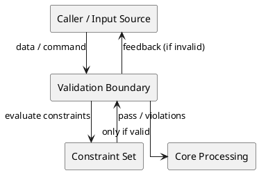

# Validation Architecture Primer

## 1. Concept Overview
- **Core idea and problem domain**  
  Validation is about protecting system integrity by controlling what is allowed to proceed.  
  It defines when data, commands, or state transitions are considered acceptable, and how violations are handled.

  The core problem it addresses:

  > Invalid input or state is cheap early and extremely expensive late.

  Validation architectures exist to:
  - Detect violations as close as possible to their source
  - Make constraints explicit and inspectable
  - Prevent propagation of invalid state through the system

- **Key identifying features**
  - Explicit definition of constraints (rules, invariants, conditions)
  - A clear validation boundary (where “untrusted” becomes “trusted”)
  - A deliberate failure strategy (fail fast vs accumulate)
  - Separation between validation logic and business behavior

---

## 2. Structural Sketch
- **Lightweight structural view**

### Main components and responsibilities

- **Caller / Input Source**:
UI, API, batch job, or integration producing data or intent.
- **Validation Boundary**:
Explicit gate where correctness is enforced.
- **Constraint Set**: Rules describing what “valid” means.
- **Core Processing**: Business logic that assumes correctness.

---

## 3. Operating Model

### Typical flow of control

- 1. Input or intent enters from a less-trusted context
- 2. Validation boundary is invoked before side effects
- 3. Constraints are evaluated
- 4. A failure strategy is applied:
    - Immediate rejection (fail fast)
    - Aggregated feedback (collect violations)
- 5. Only validated input reaches core processing

### Ownership

- Constraints are owned by the system or domain boundary
- Failure strategy is an architectural choice
- Core logic remains ignorant of validation mechanics

---

### 4. Strengths and Weaknesses

| Aspect	| Strength | 	Weakness |
|---|---|---|
| System safety	| Prevents invalid state propagation	 | Adds upfront complexity |
| Clarity	 | Makes constraints explicit	 | Poorly structured rules create noise | 
| Change tolerance	| Rules evolve independently	| Requires governance |
| Feedback  quality	 | Enables meaningful errors | 	Over-detail can overwhelm | 
| Performance	| Early rejection saves cost	| Validation has runtime overhead | 

---

## 5. When to Use / Move On

### Use when

- Data crosses trust boundaries
- Violations are costly or irreversible
- Constraints are complex or evolving
- Business logic should assume correctness

### Move on or adapt when

- Validation logic becomes business logic
- Progressive or probabilistic validation is needed
- Latency constraints dominate

---

## 6. Ecosystem Compatibility

### Fits well with

- Layered and hexagonal architectures
- Command / query separation
- Domain-driven design (boundary invariants)
- Pipeline or staged processing systems

### Less natural fit

- Highly exploratory or dynamic systems
- Purely advisory UI validation
- Post-hoc reconciliation-based systems

---

## 7. Common Variations

### Fail-Fast Validation

- Abort on first violation
- Optimizes for safety and cost avoidance
- Suitable for pipelines and irreversible actions

### Accumulating Validation

- Collect all violations
- Optimizes for feedback and correction
- Suitable for forms and configuration
- Applicable to testing/verification processes

### Tiered Validation

- Hard constraints fail fast
- Soft constraints accumulate

### Contextual Validation

- Constraints vary by role, environment, or lifecycle phase

---

## 8. Field Notes

- Implicit validation always leaks
- Business-logic validation does not scale
- Fail-fast is about respecting system cost
- Good validation systems feel boring
- Over time, constraints become living domain documentation
- Pairs well with ATDD/TDD, and similar specification-driven approaches